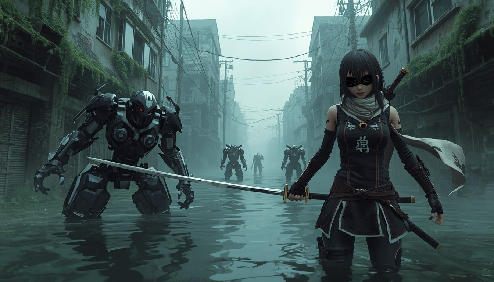

# Nier: JS

Gra MMORPG napisana w języku **JavaScript** z wykorzystaniem technologii/frameworków **NodeJS/TresJS/THREEJS/Vue/Firebase.**

Świat przedstawiony rozgrywa się w dalekiej przyszłości, po inwazji obcych, którzy prawie doszczętnie zniszczyli cywilizację ludzi. Przetrwały tylko pojedyncze jednostki, które żyją w bazach księżycowych. Wcielasz się w Androida YoRHa, skonstruowanego przez ocalałych, wysłanego na Ziemię w celu pokonania wrogów.
Zawiera w sobie także elementy z innych gatunków takich jak: hack and slash, shoot 'em up, bijatyki i tekstowej gry przygodowej.
Razem z innymi graczami eksplorujecie zrujnowane miasta i wykonujecie zadania w celu zdobycia doświadczenia i lepszych przedmiotów.

Wymagania funkcjonalne:
* Gracz będzie poruszać się w świecie trójwymiarowym, walcząc z maszynami, zbierając walutę i doświadczenie.
* Gracz będzie mógł wykonywać różne interakcje z innymi graczami.
* Gracz będzie w stanie rozwijać własną postać, zmienić jej wygląd oraz wyposażenie.

Zespół deweloperski `gra-i-trabi-zespol-kombi`:

* Mateusz Tręda *Lider Projektu, Programista*
* Karol Daniło *Programista, Front Developer*
* Ernest Miciura *Programista, Developer bazy danych*